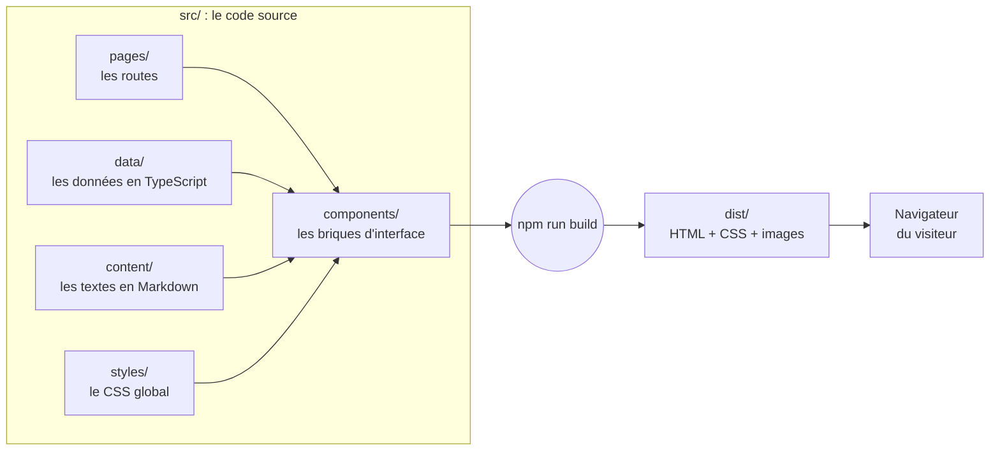
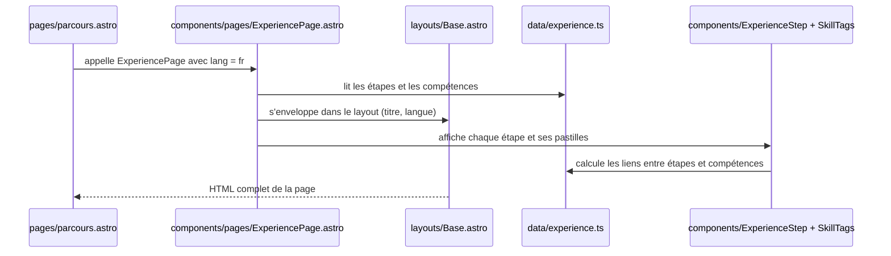
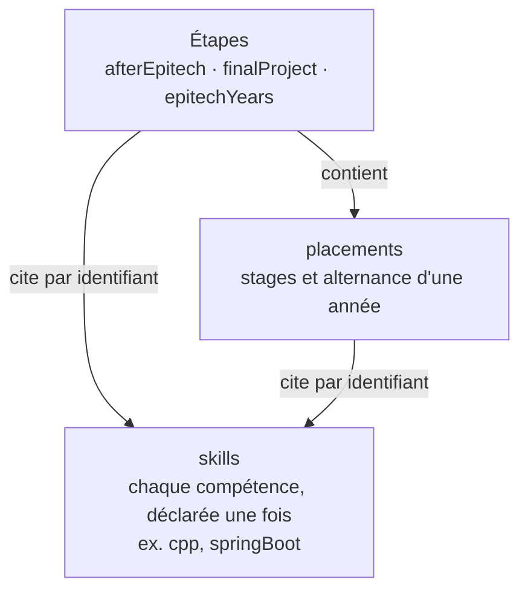
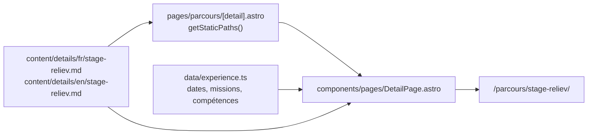
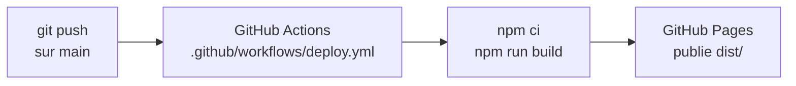

# Architecture du portfolio

Ce document explique comment le site est construit : ce que fait chaque dossier, comment une page est
fabriquée, et les mécanismes propres au projet (bilingue, compétences, pages de détail, thème).
Il s’adresse à quelqu’un qui connaît HTML, CSS et un peu de JavaScript, mais pas forcément Astro.

**Sommaire**

1. [Vue d’ensemble](#1-vue-densemble)
2. [Les dossiers et leur rôle](#2-les-dossiers-et-leur-rôle)
3. [Le parcours d’une page](#3-le-parcours-dune-page)
4. [Le bilingue](#4-le-bilingue)
5. [Les données du parcours et les compétences](#5-les-données-du-parcours-et-les-compétences)
6. [Les pages de détail](#6-les-pages-de-détail)
7. [Le CSS et le thème](#7-le-css-et-le-thème)
8. [Les images](#8-les-images)
9. [La mise en ligne](#9-la-mise-en-ligne)
10. [Glossaire](#10-glossaire)

---

## 1. Vue d’ensemble

Le site est fait avec [Astro](https://astro.build), un **générateur de site statique**. Tout le code
s’exécute **une seule fois, au moment du build** (`npm run build`), sur la machine du développeur ou
de l’hébergeur. Le résultat est un dossier `dist/` qui ne contient que des fichiers HTML, CSS et des
images. Le navigateur du visiteur reçoit ces fichiers tels quels : il n’y a ni serveur applicatif, ni
base de données, ni framework JavaScript chargé côté visiteur.



Le seul JavaScript envoyé au navigateur est celui du **bouton de thème** (clair / sombre).

**Pourquoi ce choix ?** Un portfolio n’a pas besoin d’interactivité : un site statique est rapide,
gratuit à héberger, sans faille côté serveur, et il continue de fonctionner sans maintenance.

---

## 2. Les dossiers et leur rôle

```
astro.config.mjs        configuration d'Astro (langues, adresse et sous-dossier du site)
.github/workflows/      le déploiement automatique sur GitHub Pages
CLAUDE.md               règles du projet, lues par Claude Code à chaque session
public/                 fichiers copiés tels quels : CV en PDF, favicon
src/
  pages/                les routes : un fichier = une URL
  components/           les composants d'interface
    pages/              le contenu de chaque page, partagé entre les deux langues
  layouts/Base.astro    la structure commune : <head>, en-tête, pied de page
  i18n/                 les textes d'interface et les URL, en français et en anglais
  data/                 les données structurées (parcours, compétences, coordonnées)
  content/              les textes longs en Markdown (pages de détail, projets)
  content.config.ts     le schéma qui valide le Markdown
  assets/               les images optimisées par Astro (photo de profil)
  styles/global.css     les variables CSS et les styles communs
```

Deux idées guident ce découpage :

- **Séparer le contenu du code.** Pour corriger une date ou un texte, on modifie `data/` ou `content/`,
  jamais les composants.
- **N’écrire chaque chose qu’une fois.** Une page n’est pas écrite deux fois (français et anglais), une
  compétence n’est déclarée qu’à un seul endroit, et les liens entre les pages sont calculés.

---

## 3. Le parcours d’une page

Prenons `/parcours/`, la page « Parcours et compétences ». Voici ce qui se passe au build :



1. **La route** [`src/pages/parcours.astro`](src/pages/parcours.astro) ne contient presque rien : elle
   appelle le composant de page avec la langue `fr`. Son équivalent anglais,
   [`src/pages/en/experience.astro`](src/pages/en/experience.astro), appelle le même composant avec `en`.
2. **Le composant de page** [`ExperiencePage.astro`](src/components/pages/ExperiencePage.astro) contient
   le vrai contenu, paramétré par la langue.
3. **Le layout** [`Base.astro`](src/layouts/Base.astro) ajoute ce qui est commun à toutes les pages :
   le `<head>` (titre, description, liens vers l’autre langue), l’en-tête, le pied de page.
   `<slot />` marque l’endroit où le contenu de la page s’insère.
4. **Les composants** affichent les morceaux réutilisables : une étape du parcours
   ([`ExperienceStep.astro`](src/components/ExperienceStep.astro)), une liste de pastilles
   ([`SkillTags.astro`](src/components/SkillTags.astro)).

### Anatomie d’un fichier `.astro`

```astro
---
// Partie script : du TypeScript exécuté au build, jamais dans le navigateur.
import Base from '../layouts/Base.astro';
const { lang } = Astro.props;          // les paramètres reçus du parent
---

<!-- Partie gabarit : du HTML, avec des expressions entre accolades. -->
<Base lang={lang} page="home" title="…" description="…">
  <h1>{lang === 'fr' ? 'Bonjour' : 'Hello'}</h1>
</Base>

<style>
  /* CSS limité à ce composant (voir la partie 7). */
  h1 { color: var(--accent); }
</style>
```

---

## 4. Le bilingue

Le français est à la racine du site, l’anglais sous `/en/`, et **les URL sont traduites** :

| Page | Français | Anglais |
| --- | --- | --- |
| Accueil | `/` | `/en/` |
| Projets | `/projets/` | `/en/projects/` |
| Parcours et compétences | `/parcours/` | `/en/experience/` |
| Contact | `/contact/` | `/en/contact/` |
| Détail d’une étape ou d’un stage | `/parcours/<id>/` | `/en/experience/<id>/` |

Trois fichiers gèrent tout, dans [`src/i18n/`](src/i18n/) :

- **[`ui.ts`](src/i18n/ui.ts)** contient :
  - `routes` : l’URL de chaque page dans chaque langue ;
  - `ui` : tous les textes d’interface (menus, boutons, titres), une clé par texte, en français et en anglais.
- **[`utils.ts`](src/i18n/utils.ts)** fournit les fonctions à utiliser partout :
  - `useTranslations(lang)` renvoie une fonction `t('nav.home')` qui donne le texte dans la bonne langue ;
  - `pagePath('experience', 'en')` renvoie `/claude-portfolio/en/experience/` : l’URL de la page, précédée
    du sous-dossier où le site est publié (voir la partie 9). **Aucune URL interne n’est écrite en dur** ;
  - `detailPath(id, lang)` construit l’URL d’une page de détail.
- **[`projects.ts`](src/i18n/projects.ts)** récupère les projets d’une langue.

**TypeScript vérifie les textes.** Le type `UiKey` est la liste exacte des clés de `ui` : écrire
`t('nav.projet')` avec une faute de frappe est signalé dans l’éditeur.

Le bouton « EN / FR » de l’en-tête mène à **la même page** dans l’autre langue. Pour une page de détail,
le layout reçoit les deux URL exactes par la prop `paths`.

---

## 5. Les données du parcours et les compétences

Tout le parcours est décrit dans [`src/data/experience.ts`](src/data/experience.ts), sous forme de
données TypeScript. Chaque texte existe en deux langues côte à côte :

```ts
title: { fr: '2e année', en: '2nd year' }
```

Le type `Text = Record<Lang, string>` oblige à fournir les deux : une traduction oubliée fait échouer
le build.

### Trois sortes de données



- **`skills`** déclare chaque compétence une seule fois, avec un identifiant (`cpp`) et un groupe
  (Programmation, Back-end…).
- **Les étapes** : l’après-Epitech (`afterEpitech`), le projet de fin d’études (`finalProject`) et les
  années d’Epitech (`epitechYears`), de la plus récente à la plus ancienne.
- **Les `placements`** : les stages et l’alternance, rattachés à leur année. Le champ `kind` vaut
  `'internship'` (stage) ou `'workStudy'` (alternance).

Les étapes **citent** les compétences par leur identifiant (`skills: ['c', 'linux', 'git']`), comme une
clé étrangère dans une base de données.

### Le lien automatique entre parcours et compétences

La section Compétences, en haut de la page Parcours, n’est écrite nulle part à la main : elle est
**calculée**.

- `skillGroupList(lang)` donne les groupes et leurs compétences.
- `skillUsage(id, lang)` parcourt toutes les étapes et renvoie celles qui citent une compétence, de la
  plus récente à la plus ancienne.
- [`SkillTags.astro`](src/components/SkillTags.astro) affiche les pastilles :
  - **dans une étape**, une pastille renvoie vers la compétence, en haut de la page ;
  - **dans la section Compétences**, une pastille renvoie vers l’étape la plus récente qui l’utilise,
    et une bulle « Utilisé dans : … » l’annonce au survol.

Ces liens sont des **ancres** : `href="#competence-cpp"` mène à l’élément dont l’`id` vaut
`competence-cpp`. Les deux valeurs viennent de la même fonction, `skillAnchor()`, donc elles ne peuvent
pas diverger.

### Le rôle de TypeScript

```ts
const skills = { cpp: { … }, java: { … } } satisfies Record<string, Skill>;
export type SkillId = keyof typeof skills;   // 'cpp' | 'java' | …
```

`satisfies` vérifie que chaque compétence a la bonne forme **tout en gardant** les clés exactes. Résultat :
`SkillId` est la liste des identifiants valides, et citer une compétence qui n’existe pas
(`skills: ['rust']`) est refusé.

---

## 6. Les pages de détail

Certaines étapes (le Japon, la Corée) et tous les stages ont une page de détail, avec un texte long.



- **Le texte** est un fichier Markdown par langue, dans [`src/content/details/`](src/content/details/).
  Le nom du fichier est l’`id` de l’étape ou du stage dans `experience.ts`.
- **La collection** `details`, déclarée dans [`content.config.ts`](src/content.config.ts), fait lire ces
  fichiers par Astro et valide leur en-tête (le *frontmatter*) avec un schéma.
- **La route dynamique** [`src/pages/parcours/[detail].astro`](src/pages/parcours/[detail].astro) : les
  crochets indiquent un paramètre d’URL. Sa fonction `getStaticPaths()` liste au build les pages à
  générer, une par fichier Markdown.
- **[`DetailPage.astro`](src/components/pages/DetailPage.astro)** assemble la page : l’en-tête vient de
  `experience.ts`, le texte du Markdown. `findDetailTarget(id)` indique s’il s’agit d’une étape ou d’un
  stage, pour adapter l’en-tête.

**Des garde-fous au build.** [`src/data/details.ts`](src/data/details.ts) fait échouer le build, avec un
message qui désigne le fichier à corriger, si :

- un fichier ne correspond à aucune étape ni aucun stage ;
- un fichier existe dans une langue mais pas dans l’autre ;
- un détail cite un projet personnel qui n’existe pas.

Une page de détail n’existe que si ses deux fichiers existent ; la carte du parcours affiche alors
automatiquement le lien « Voir le détail ».

### La page Projets

Elle fonctionne sur le même principe, avec la collection `projects` (un Markdown par projet et par
langue). Elle est vide pour l’instant : la page affiche « en construction » et le bouton principal de
l’accueil mène au parcours. Tout redevient normal dès le premier projet ajouté.

---

## 7. Le CSS et le thème

### Deux niveaux de CSS

- **[`global.css`](src/styles/global.css)** : les variables (couleurs, espacements, polices) et les
  styles communs (boutons, pastilles, conteneurs).
- **Une balise `<style>` dans chaque composant** : Astro la limite à ce composant. Il ajoute un attribut
  aux éléments du composant (`data-astro-cid-…`) et réécrit les sélecteurs en conséquence :

  ```css
  /* écrit */     .tags li:has(a) { … }
  /* généré */    .tags[data-astro-cid-3oxtwdse] li[data-astro-cid-3oxtwdse]:has(a) { … }
  ```

  Un `.title` dans un composant ne peut donc pas casser un `.title` ailleurs. Pour viser un élément qui
  n’appartient pas au composant, comme le HTML produit par le Markdown, on utilise `:global(…)`.

### Le thème clair / sombre

Toutes les couleurs passent par des variables CSS. Le thème clair ne fait que les redéfinir :

```css
:root                     { --bg: #0f1115; --text: #e6e8ee; }
:root[data-theme='light'] { --bg: #fbfbfd; --text: #16181d; }
```

Changer de thème revient à changer un seul attribut sur `<html>`. Deux scripts s’en chargent :

- **dans le `<head>` de `Base.astro`** (`is:inline`) : il lit le choix mémorisé avant l’affichage de la
  page, pour éviter un flash de la mauvaise couleur au chargement ;
- **dans [`ThemeToggle.astro`](src/components/ThemeToggle.astro)** : au clic, il inverse l’attribut et
  enregistre le choix dans `localStorage`.

### Les techniques CSS à connaître dans ce projet

| Technique | Où | Rôle |
| --- | --- | --- |
| `repeat(auto-fill, minmax(17rem, 1fr))` | grilles | autant de colonnes que la largeur permet, sans media query |
| `:target` | étapes, pastilles | met en évidence l’élément visé par l’ancre de l’URL, sans JavaScript |
| `:has(a)` | pastilles | cible un parent selon son contenu |
| `transition-delay` | bulle des compétences | fait apparaître la bulle après un temps de survol |
| `object-fit` / `object-position` | photo de profil | recadre l’image en CSS, sans la modifier |
| `padding-inline`, `border-inline-start` | partout | propriétés logiques, qui suivent le sens de lecture |

### L’accessibilité

HTML sémantique (`<header>`, `<nav>`, `<main>`, `<article>`), un seul `h1` par page, lien d’évitement
« Aller au contenu », `aria-current` sur le lien de la page courante, texte alternatif obligatoire sur les
images, focus visible au clavier, et animations coupées si le système le demande
(`prefers-reduced-motion`).

---

## 8. Les images

| Où | Pour quoi | Traitement |
| --- | --- | --- |
| `src/assets/` | photo de profil | optimisée par `<Image>` d’Astro : redimensionnée, convertie en WebP |
| `src/content/details/images/` | images des pages de détail | insérées en Markdown, optimisées au build |
| `public/` | CV, favicon | copiées telles quelles, sous leur nom d’origine |

Les schémas et cartes (ECG, architecture Télélogos, parcours au Japon) sont des fichiers **SVG** :
du dessin vectoriel écrit en texte, net à toutes les tailles. Les illustrations des stages confidentiels
utilisent des données fictives. Les deux photos de la Corée du Sud viennent de Wikimedia Commons, sous
licence CC BY-SA 3.0, et sont créditées dans leur légende.

---

## 9. La mise en ligne

Le site est publié sur **GitHub Pages**, à l’adresse https://ugo-boulestreau.github.io/claude-portfolio/.



À chaque push sur `main`, le workflow [`deploy.yml`](.github/workflows/deploy.yml) fait sur les serveurs de
GitHub ce que vous feriez en local : installer les dépendances (`npm ci`), construire le site
(`npm run build`), puis publier le dossier `dist/`. Son avancement se suit dans l’onglet **Actions** du dépôt.

### Le sous-dossier `/claude-portfolio`

GitHub Pages publie le site dans un sous-dossier qui porte le nom du dépôt. Deux réglages de
[`astro.config.mjs`](astro.config.mjs) le prennent en compte :

- **`base: '/claude-portfolio'`** : Astro l’expose dans `import.meta.env.BASE_URL`, et `pagePath()` comme
  `assetPath()` l’ajoutent devant chaque lien interne. C’est la raison de la règle « aucune URL interne en
  dur » : un `href="/parcours/"` écrit à la main mènerait en ligne à une page introuvable.
- **`site: 'https://ugo-boulestreau.github.io'`** : il permet de construire les adresses complètes
  utilisées par les moteurs de recherche et les réseaux sociaux (URL canonique, liens `hreflang`, Open Graph).

En local, le serveur de développement applique le même sous-dossier : le site est à
http://localhost:4321/claude-portfolio/.

Les liens écrits dans le Markdown des pages de détail sont **relatifs** (`../stage-reliev/`) : ils
fonctionnent quel que soit le sous-dossier.

---

## 10. Glossaire

| Terme | Définition |
| --- | --- |
| **Ancre** | Lien vers un endroit de la page (`href="#id"`), qui fait défiler jusqu’à l’élément ayant cet `id`. |
| **Build** | Étape qui transforme le code source en site final (`npm run build` → `dist/`). |
| **Collection de contenu** | Ensemble de fichiers Markdown lus par Astro et validés par un schéma. |
| **Composant** | Morceau d’interface réutilisable, qui reçoit des paramètres (les *props*). |
| **Frontmatter** | En-tête d’un fichier Markdown, entre `---`, qui contient ses données. |
| **Layout** | Composant qui définit la structure commune à plusieurs pages. |
| **Props** | Paramètres passés à un composant, comme les arguments d’une fonction. |
| **Route dynamique** | Fichier de route avec un paramètre (`[detail].astro`), qui génère plusieurs pages. |
| **Scoped (CSS)** | Styles limités au composant qui les déclare. |
| **Site statique** | Site fait uniquement de fichiers préparés à l’avance, sans calcul côté serveur. |
| **WebP** | Format d’image moderne, plus léger que JPEG ou PNG à qualité égale. |
| **Workflow** | Suite d’étapes automatisées que GitHub Actions exécute à un événement donné, ici chaque push sur `main`. |
