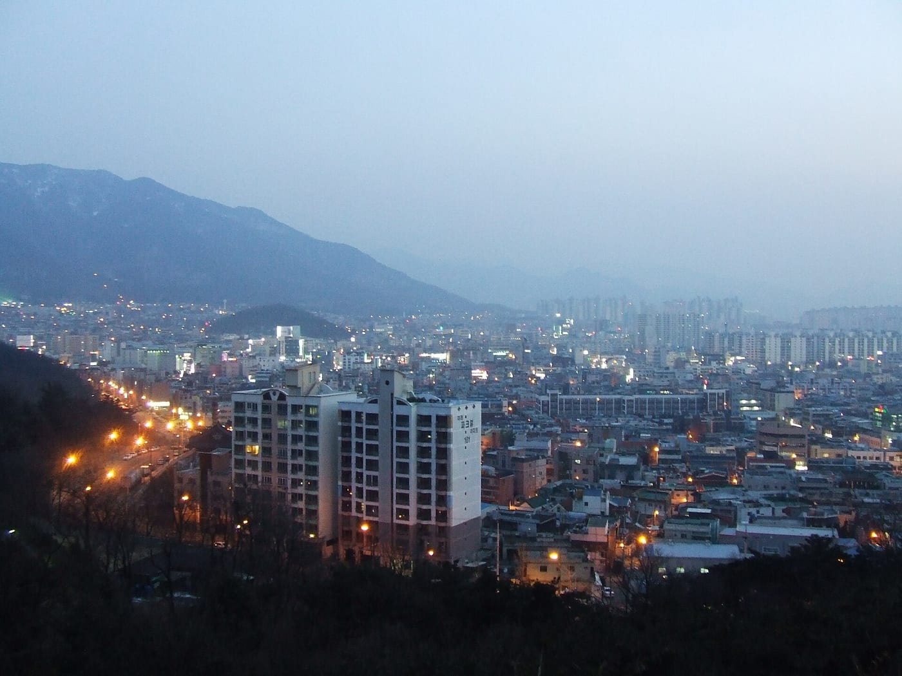
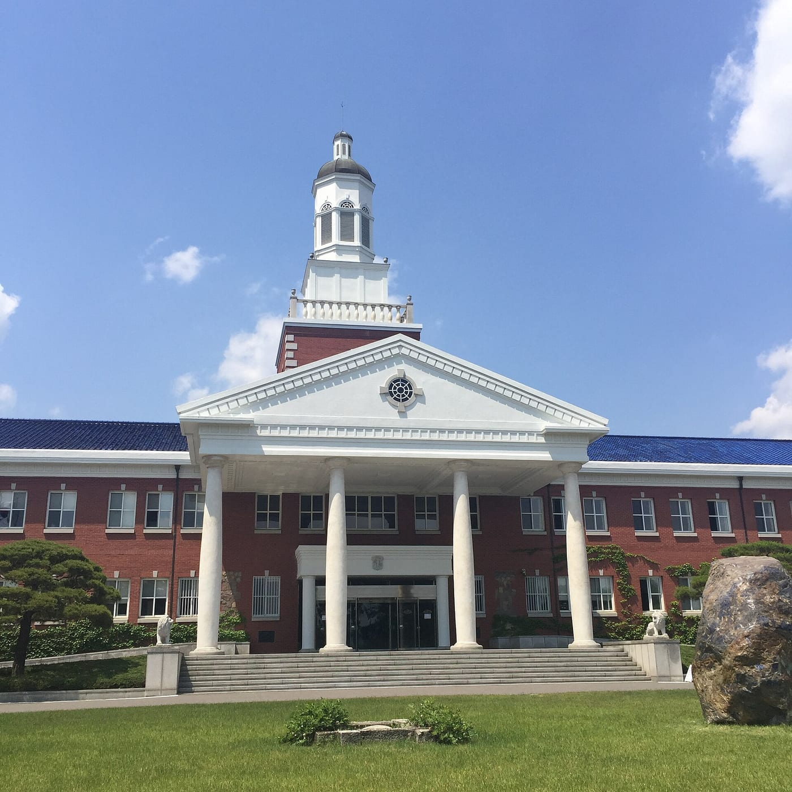

## Context

Epitech offers its students the chance to spend their 4th year abroad, through partnerships with universities in many countries. I spent the 2023 – 2024 academic year in South Korea, at Keimyung University in Daegu.

This year was very rewarding, both academically and personally.

*Daegu at dusk, seen from Duryu Park. Photo: [Namoroka](https://commons.wikimedia.org/wiki/File:View_of_Dalseo-gu_in_Daegu_from_Daegu_Duryu_Park.JPG), [CC BY-SA 3.0](https://creativecommons.org/licenses/by-sa/3.0/), via Wikimedia Commons.*

## Video games with Unity and Unreal Engine

*The main building of Keimyung University. Photo: [Tndus1108](https://commons.wikimedia.org/wiki/File:Keimyung_University_Main_Building.jpg), [CC BY-SA 3.0](https://creativecommons.org/licenses/by-sa/3.0/), via Wikimedia Commons.*

Video games were at the core of my programme. Using the Unity and Unreal Engine game engines, we built a range of game-related projects, including two complete games made with Unity.

### A baseball-themed roguelike

A top-down roguelike: a genre where every run is played on randomly generated levels. Its core mechanic was bouncing projectiles, with a baseball theme. The game had two or three types of enemies and a boss.

I was in charge of **random map generation**, the building block that makes every run different.

### A deliberately goofy fighting game

A top-down fighting game where the goal was to knock your opponent out of a ring. The main objective was an exaggerated *ragdoll* physics (characters with floppy, limp bodies), for a goofy and funny feel.

I took on several roles: **the map, the physics and the weapons**.

## NOLOSAY, a remote project

Alongside this, we kept working on our final-year project, NOLOSAY, a project making written French more accessible to people who are hard of hearing. Started in 3rd year and carried through to 5th year, it brought together seven Epitech students spread across the globe during their year abroad: we therefore had to collaborate entirely remotely.

We communicated on Microsoft Teams and worked on a shared Git repository, with a weekly team meeting and a monthly meeting with a supervisor. I partly handled the **back-end** and the **CI** (continuous integration).

## The language club

During the year, we joined a language club where Korean people came to meet English speakers. We met many Korean people there and shared lots of moments with them, while improving our communication in English. We also took Korean classes, but I only kept the basics: day to day, we mostly communicated in English.

## What I learned

This year introduced me to a new field, game development, where I worked on a variety of topics: procedural generation, physics, gameplay. On NOLOSAY, I learned to work remotely in a team of seven, with tools and routines to stay coordinated. Living in Korea and speaking English every day also made me more comfortable communicating in an international setting.
