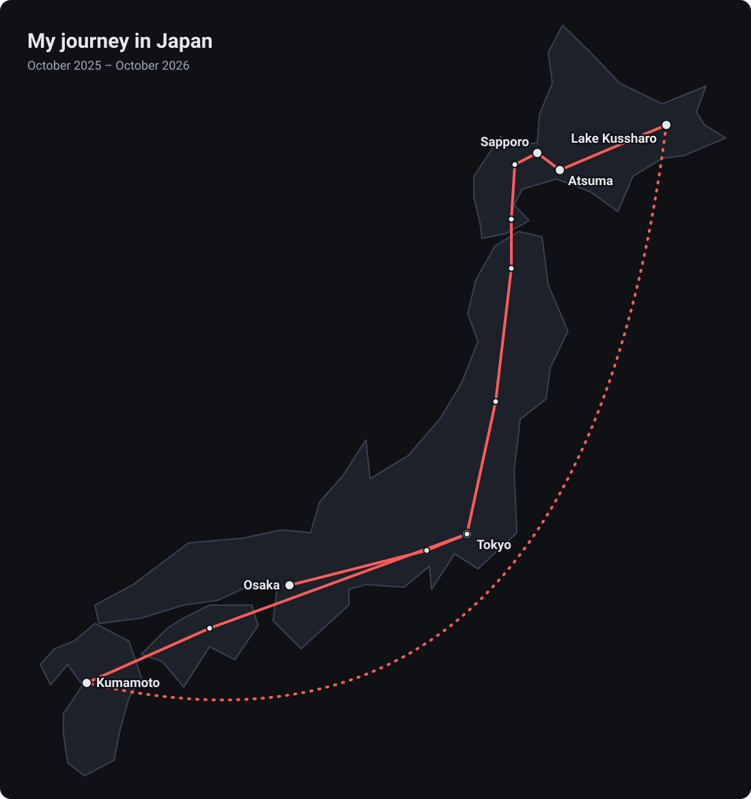

## Why Japan

After graduating, I chose to take a gap year to grow personally before starting my career. A fan of anime and manga, and of Japanese culture more broadly, I went to Japan on a Working Holiday visa, from October 2025 to October 2026.

I set off with my two best friends. The first one went back to France at the end of February, the second in May: I spent the last five months on my own, my first long solo trip abroad.

## What I did there

I lived mostly on my savings this year, and took on several volunteering assignments. Everything happened in English: our Japanese wasn’t yet good enough to work in the language.

### Kitchen volunteering in Kyushu · 3 weeks

With other volunteers from different countries, I designed and cooked dishes for a range of diets: vegetarian, gluten-free or omnivore. The work was organised in two shifts, which we shared out at the start of each week: mornings from 10 am to 2 pm, and evenings from 6 pm to 10 pm.

This experience called for cooperation, improvisation, communication and real teamwork, with people from very different backgrounds.

### Guesthouse volunteering in Atsuma · 1 week

In Hokkaido, I prepared breakfasts and cleaned the rooms of a guesthouse. I also spoke English with Japanese middle-school students who were learning the language.

I also spent three days on a farm near Lake Kussharo, a volunteering stint cut short for personal reasons.

### Japanese and keeping up with tech

I taught myself Japanese, with online resources and above all by practising with locals. I didn’t reach a certified level (JLPT), but this everyday practice was at the heart of my year.

While I didn’t code during this time, I kept up with what was happening in software development, especially the rise of AI coding agents such as Claude Code.

## What I learned

Paperwork was the biggest challenge. Getting the visa was long and tedious. Once there, formalities such as health insurance were entirely in Japanese, poorly explained, and the staff I dealt with didn’t speak English. The five months on my own, in a country whose language is so far from French, also showed me both the advantages and the drawbacks of complete independence.

This year proved my ability to adapt quickly to a foreign environment and find my footing there, and to work as part of a team in English with people from all over the world. It’s the same adaptability I rely on as a developer, when facing a new codebase or a new technology.

## Bonus: my journey

*My route through Japan, from Osaka to Tokyo by way of Hokkaido and Kyushu.*

With my two friends, we first lived in Osaka for four months, exploring the Kansai region: Kyoto, Nara, Lake Biwa, Shikoku and Hiroshima. At the end of January, we headed north to Hokkaido via Mount Fuji, Tokyo and the Tohoku region, with two weeks in Sapporo and the volunteering stint in Atsuma. After my first friend left at the end of February, the two of us went on to Lakes Kussharo and Mashu, then lived in Kumamoto, in Kyushu, for a month. In May, my second friend went home in turn: after my volunteering in Kyushu, I travelled up to Tokyo via Shikoku, where I lived from mid-June until the end of my Working Holiday.
