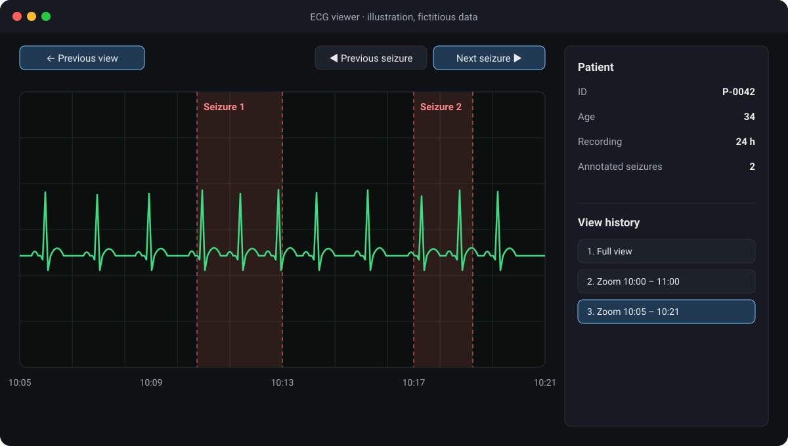

## Context

For my 3rd year at Epitech, I joined Reliev, a health-tech start-up based in Nantes and focused on epilepsy. Founded in March 2021, it had six people during my internship and was based at the Cantine numérique, a tech hub in Nantes.

Reliev works with hospitals and research laboratories, including Nantes University Hospital (CHU de Nantes) and Inserm, the French national health research institute. Its goal: improve the follow-up of people with epilepsy and, using artificial intelligence, detect and anticipate seizures.

The team worked in an agile way, with a weekly meeting on Fridays. Tasks were tracked on Trello, and communication went through Google Workspace (Chat, Meet, Calendar, Gmail).

## What I built

I worked on the R&D team’s tool for visualising ECG signals. An electrocardiogram records the heart’s electrical activity at every beat; these signals are part of the data Reliev uses to monitor epilepsy.

*An ECG trace: each heartbeat produces a P wave, a QRS complex and a T wave.*

The tool did no detection itself: the artificial intelligence algorithms that detected seizures were developed separately. The interface was used to prepare their training data: going through the recordings, the team manually annotated seizures, and these annotations, used for supervised learning, let the AI correct its mistakes and refine its automatic detection.

The tool was a web application written in object-oriented Python, with Dash, Plotly’s web framework, and Matplotlib. It already had many features, to which I added three main ones to make this annotation work easier:

- **A view history**, to go back to previous zoom levels and positions: you can explore a detail of the signal, then return to the overview.
- **A shortcut to jump between seizures**, going straight from one seizure annotation to the next instead of scrolling through the whole recording.
- **Display of patient metadata**, whose type could vary: the mock-up below shows an example.

*Illustration with a fictitious tool and fictitious data: the real tool and its data are confidential.*

The main challenge was the interface slowing down on the heaviest signals. I couldn’t fix it on my own, but with the team’s help we managed to improve its performance.

## What I learned

This second internship of my degree was very rewarding, both technically, as I discovered web development in Python with Dash and Plotly, professional CI/CD pipelines with Jenkins and GitLab, and deepened my knowledge of Docker, and personally, working within a small, close-knit team alongside healthcare professionals who introduced me to the medical world and to epilepsy.

I later got back in touch with Reliev for my 5th-year work-study placement: the team gladly welcomed me back, on a similar assignment.
