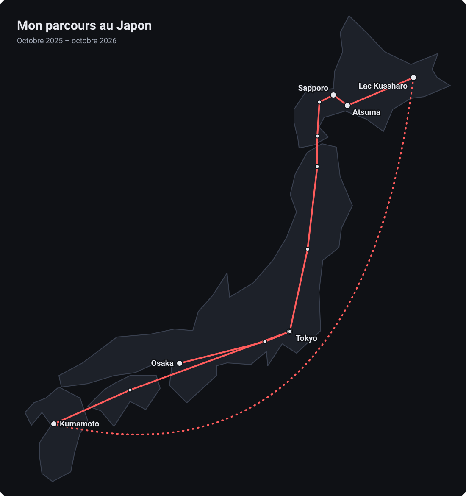

## Pourquoi le Japon

Après mon diplôme, j’ai choisi de prendre une année sabbatique pour m’enrichir personnellement avant d’entrer dans la vie professionnelle. Amateur d’animes et de mangas, et plus largement de culture japonaise, je suis parti au Japon avec un Programme Vacances-Travail (PVT), d’octobre 2025 à octobre 2026.

Je suis parti avec mes deux meilleurs amis. Le premier est rentré en France fin février, le second en mai : j’ai vécu les cinq derniers mois seul, mon premier long voyage en solo à l’étranger.

## Ce que j’y ai fait

J’ai vécu cette année principalement sur mes économies, et j’ai effectué plusieurs missions de volontariat. Sur place, tout se passait en anglais : notre japonais n’était pas encore suffisant pour travailler dans la langue.

### Volontariat en cuisine dans le Kyushu · 3 semaines

Avec d’autres volontaires venus de différents pays, je concevais et préparais des plats pour des régimes variés : végétariens, sans gluten ou omnivores. Le travail était organisé en deux services, que nous nous répartissions en début de semaine : le matin, de 10 h à 14 h, et le soir, de 18 h à 22 h.

Cette expérience m’a demandé de la coopération, de l’improvisation, de la communication et un vrai travail d’équipe, avec des personnes d’horizons très différents.

### Volontariat dans une guesthouse à Atsuma · 1 semaine

À Hokkaido, je préparais les petits-déjeuners et je nettoyais les chambres d’une guesthouse. J’y ai aussi échangé en anglais avec des collégiens japonais qui apprenaient la langue.

J’ai également passé trois jours dans une ferme près du lac Kussharo, un volontariat écourté pour des raisons personnelles.

### Le japonais et la veille technologique

J’ai appris le japonais en autodidacte, avec des ressources en ligne et surtout en pratiquant avec des locaux. Je n’ai pas atteint un niveau certifié (JLPT), mais cette pratique au quotidien a été au cœur de mon année.

Sans coder pendant cette période, j’ai continué à suivre l’actualité du développement, en particulier l’essor des agents IA de programmation comme Claude Code.

## Ce que j’en retiens

Les démarches administratives ont été le plus grand défi. Obtenir le visa a été long et fastidieux. Une fois sur place, les formalités comme l’assurance santé se faisaient entièrement en japonais, avec des explications peu claires et des interlocuteurs qui ne parlaient pas anglais. Les cinq mois passés seul, dans un pays dont la langue est si éloignée du français, m’ont aussi fait découvrir les avantages comme les inconvénients d’une autonomie complète.

Cette année a prouvé ma capacité à m’adapter rapidement à un environnement étranger et à y trouver ma place, et à travailler en équipe en anglais avec des personnes venues du monde entier. C’est la même capacité d’adaptation que je mobilise en développement, face à une nouvelle base de code ou une nouvelle technologie.

## Bonus : mon parcours

*Mon itinéraire au Japon, d’Osaka à Tokyo en passant par Hokkaido et le Kyushu.*

Avec mes deux amis, nous avons d’abord vécu quatre mois à Osaka, en explorant le Kansai : Kyoto, Nara, le lac Biwa, le Shikoku et Hiroshima. Fin janvier, nous sommes remontés jusqu’à Hokkaido par le mont Fuji, Tokyo et le Tohoku, avec deux semaines à Sapporo et le volontariat à Atsuma. Après le départ de mon premier ami, fin février, nous sommes passés à deux par les lacs Kussharo et Mashu, puis avons vécu un mois à Kumamoto, dans le Kyushu. En mai, mon second ami est rentré à son tour : après mon volontariat dans le Kyushu, je suis remonté à Tokyo par le Shikoku, où j’ai vécu de mi-juin jusqu’à la fin de mon PVT.
