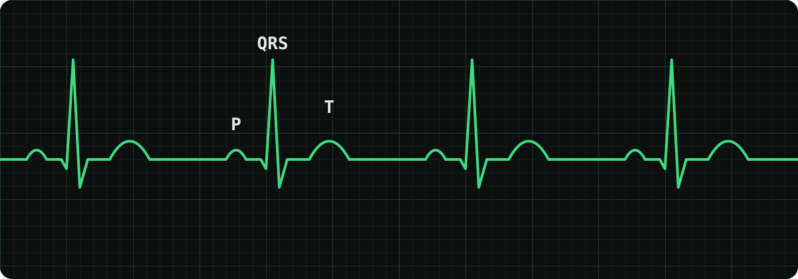
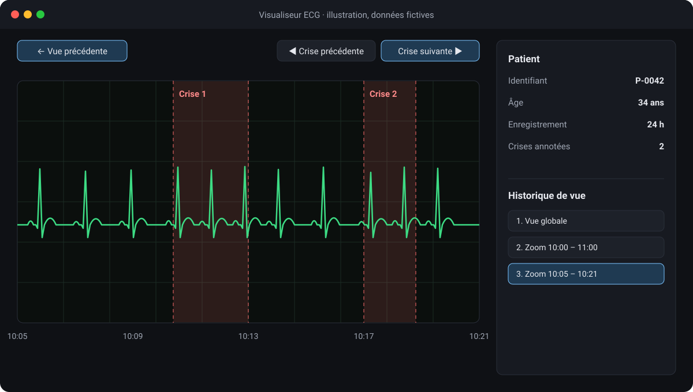

## Contexte

Pour ma 3e année à Epitech, j’ai rejoint Reliev, une start-up nantaise de la santé spécialisée dans l’épilepsie. Fondée en mars 2021, elle comptait six personnes pendant mon stage et était installée à la Cantine numérique de Nantes.

Reliev travaille avec des hôpitaux et des laboratoires de recherche, dont le CHU de Nantes et l’Inserm. Son objectif : améliorer le suivi des patients épileptiques et, grâce à l’intelligence artificielle, détecter et anticiper les crises.

L’équipe fonctionnait en méthode agile, avec un point hebdomadaire le vendredi. Les tâches étaient suivies sur Trello, et la communication passait par Google Workspace (Chat, Meet, Agenda, Gmail).

## Ce que j’ai réalisé

J’ai travaillé sur l’outil de visualisation de signaux ECG de l’équipe R&D. L’électrocardiogramme enregistre l’activité électrique du cœur à chaque battement ; ces signaux font partie des données qu’utilise Reliev pour suivre l’épilepsie.

*Un tracé ECG : chaque battement du cœur produit une onde P, un complexe QRS et une onde T.*

Cet outil ne faisait aucune détection lui-même : les algorithmes d’intelligence artificielle chargés de détecter les crises étaient développés séparément. L’interface servait à préparer leurs données d’entraînement : en parcourant les enregistrements, l’équipe annotait manuellement les crises, et ces annotations, utilisées pour l’apprentissage supervisé, permettaient à l’IA de corriger ses erreurs et d’affiner sa détection automatique.

L’outil était une application web écrite en Python orienté objet, avec Dash, le framework web de Plotly, et Matplotlib. Il comportait déjà de nombreuses fonctionnalités, auxquelles j’en ai ajouté trois principales pour faciliter ce travail d’annotation :

- **Un historique de vue**, pour revenir aux zooms et positions précédents : on peut explorer un détail du signal, puis retrouver sa vue d’ensemble.
- **Un raccourci de navigation entre les crises**, pour passer directement d’une annotation de crise à l’autre au lieu de parcourir tout l’enregistrement.
- **L’affichage des métadonnées du patient**, dont le type pouvait varier : la maquette ci-dessous en montre un exemple.

*Illustration avec un outil et des données fictifs : l’outil réel et ses données sont confidentiels.*

La principale difficulté a été la lenteur de l’interface sur les signaux les plus lourds. Je n’ai pas réussi à la corriger seul, mais avec l’aide de l’équipe, nous avons pu améliorer ses performances.

## Ce que j’en retiens

Ce deuxième stage a été très enrichissant, autant sur le plan technique, avec la découverte du développement web en Python avec Dash et Plotly, des pipelines CI/CD professionnels avec Jenkins et GitLab et un approfondissement de Docker, que sur le plan humain, au sein d’une petite équipe soudée et aux côtés de professionnels de santé qui m’ont fait découvrir le monde médical et l’épilepsie.

J’ai d’ailleurs recontacté Reliev pour mon alternance de 5e année : l’équipe m’a accueilli de nouveau avec plaisir, sur une mission similaire.
